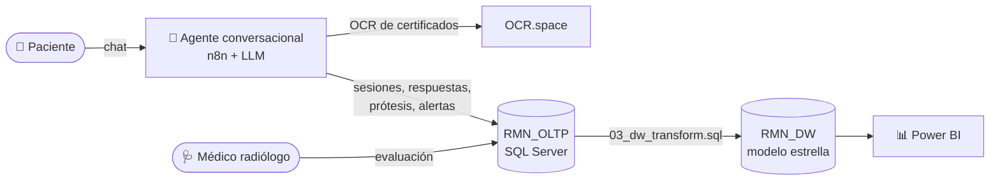
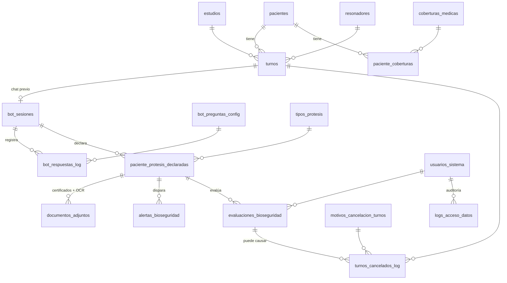

# 🧲 Agente de IA Conversacional para Bioseguridad en Resonancia Magnética

> Proyecto final — Tecnicatura en Ciencia de Datos e Inteligencia Artificial (IFTS)

Un asistente conversacional que realiza el **cuestionario de bioseguridad** a los pacientes **antes de un estudio de Resonancia Magnética Nuclear (RMN)**. Detecta prótesis, implantes y dispositivos electrónicos, y genera **alertas automáticas** para que el equipo médico evalúe la compatibilidad antes del turno.

Este repositorio contiene la **capa de datos** del proyecto:

- la base transaccional (**OLTP**) donde el agente registra sesiones, respuestas y declaraciones;
- el **Data Warehouse** en modelo estrella;
- el proceso de **transformación OLTP → DW**;
- el **tablero de Power BI** con los indicadores del servicio.

---

## 📌 El problema

Antes de una RMN hay que confirmar que el paciente no tiene elementos incompatibles con el campo magnético, como marcapasos, implantes metálicos o neuroestimuladores. Hoy esa verificación suele hacerse a último momento y en papel. Eso trae dos consecuencias:

- turnos cancelados en la sala de espera;
- riesgo para el paciente si algo no se declara.

**La propuesta:** que el paciente responda el cuestionario por chat con anticipación, y que cada prótesis declarada dispare una alerta (objetivo: **en menos de 60 segundos**) que un médico radiólogo evalúa y clasifica como *MR Safe*, *MR Conditional* o *MR Unsafe*.

---

## 🏗️ Arquitectura



---

## 🗄️ Base transaccional — `RMN_OLTP`

Son 18 tablas que modelan el circuito completo, desde el turno hasta la evaluación médica:



**Decisiones de diseño destacadas**

- **Reglas de negocio en la base.** Los estados válidos de turnos, sesiones, alertas y evaluaciones se controlan con `CHECK`.
- **Índices únicos filtrados**:
  - una sola evaluación abierta por declaración (`UX_evaluacion_abierta_por_declaracion`);
  - una sola cobertura principal por paciente (`UX_paciente_cobertura_principal`).
- **Cuestionario configurable.** Las preguntas del bot viven en `bot_preguntas_config` con orden, criticidad y a quién aplican (`Todos` / `Mujeres`). Se pueden cambiar sin tocar el flujo.
- **Auditoría.** `logs_acceso_datos` registra quién accede a datos de pacientes y qué acción realiza.

---

## ⭐ Data Warehouse — `RMN_DW`

Es un modelo estrella con **4 tablas de hechos** y **8 dimensiones**:

| Hechos | Granularidad | Métricas clave |
|---|---|---|
| `fact_turnos` | 1 fila por turno | estado, días de anticipación, `tuvo_sesion` |
| `fact_sesiones` | 1 fila por sesión de chat | duración, preguntas respondidas, `tuvo_alerta` |
| `fact_alertas_bioseguridad` | 1 fila por alerta | `segundos_alerta`, horas de resolución |
| `fact_evaluaciones_bioseguridad` | 1 fila por evaluación | resultado de compatibilidad, horas de evaluación |

**Dimensiones:** `dim_tiempo`, `dim_paciente`, `dim_estudio`, `dim_resonador`, `dim_motivo_cancelacion`, `dim_tipo_protesis`, `dim_protesis_declarada`, `dim_usuario`.

El script de transformación es **repetible**: vacía y recarga el DW. Además incluye **controles de calidad** al final:

- conteos esperados por tabla;
- hechos sin dimensión;
- coherencia entre `tuvo_sesion` y las sesiones cargadas;
- alertas que superan los 60 s.

---

## 📊 Tablero de Power BI

El tablero tiene 4 páginas con navegación y filtros por año y modalidad:

| Página | Qué muestra |
|---|---|
| **Resumen** | Turnos, sesiones, declaraciones y alertas abiertas. Evolución mensual, prótesis más declaradas y resultados de compatibilidad. |
| **Turnos** | % de cancelación e inasistencia, turnos por estudio y por resonador, motivos de cancelación. |
| **Chatbot** | % de finalización, duración promedio y embudo *Turnos RMN → con sesión → finalizadas → con alerta*. Compara cancelación e inasistencia **con y sin chat previo**. |
| **Bioseguridad** | Tiempo hasta la alerta (promedio y máximo), alertas por tipo, urgencia y estado, resultados *MR Safe / Conditional / Unsafe*. |

Las **41 medidas DAX** están exportadas como texto en [`powerbi/medidas.dax`](powerbi/medidas.dax). Se pueden revisar sin abrir Power BI.

<!-- 📸 Agregar capturas del tablero en docs/img/ y descomentar:


-->

---

## 📁 Estructura del repositorio

```
├── sql/
│   ├── 01_oltp_ddl.sql        # Crea RMN_OLTP (tablas, restricciones, índices)
│   ├── 02_dw_ddl.sql          # Crea RMN_DW y el esquema dw (⚠️ borra la base si existe)
│   └── 03_dw_transform.sql    # Carga el DW desde el OLTP + controles de calidad
├── powerbi/
│   ├── IA_conversacional_resonancia_magnetica.pbix
│   └── medidas.dax            # Medidas del modelo en texto plano
└── docs/img/                  # Capturas del tablero
```

## 🚀 Cómo reproducirlo

Requisitos: **SQL Server 2022** (nivel de compatibilidad 160) y **Power BI Desktop**.

1. Ejecutar `sql/01_oltp_ddl.sql` en SSMS.
2. Poblar `RMN_OLTP` con los datos del agente o con datos de prueba.
3. Ejecutar `sql/02_dw_ddl.sql` y luego `sql/03_dw_transform.sql`.
4. Revisar que los controles del final del transform den lo esperado.
5. Abrir el `.pbix`, apuntar el origen de datos a tu instancia (`RMN_DW`) y actualizar.

---

## 🛠️ Tecnologías

`SQL Server` · `T-SQL` · `Power BI` · `DAX` · `n8n` · `Mistral (LLM)` · `OCR.space`

## 👥 Equipo

| Integrante | Rol |
|---|---|
| Geremias Gularte | Infraestructura y Seguridad |
| Diana Camacho | |
| Viviana Leiva | |
| Juan Taborda | |

**Docente:** Valeria Feito

> ⚠️ Todos los datos de pacientes del proyecto son **ficticios** y fueron generados con fines académicos.
